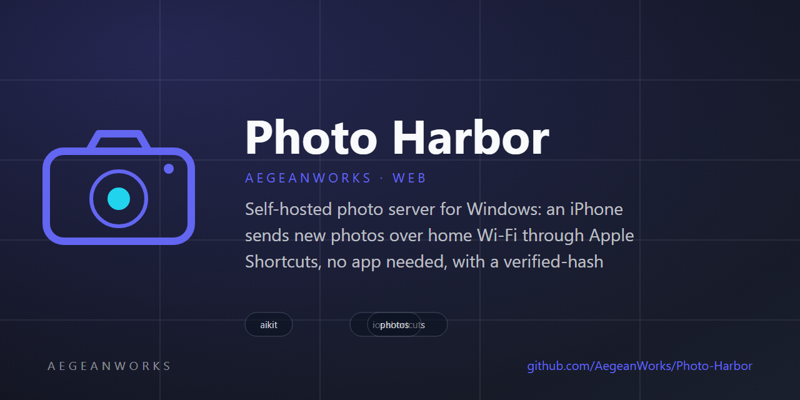
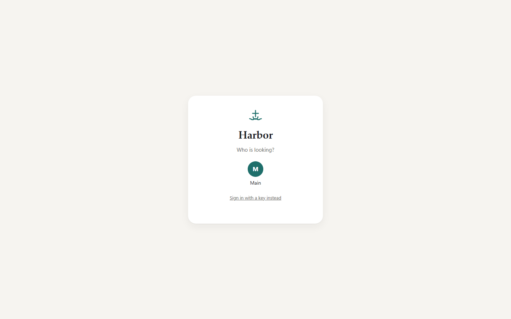

# photo-harbor

<!-- aegean:media:start -->
<p align="center"></p>
<p align="center"><a href="LICENSE"></a> <a href="https://github.com/AegeanWorks/AIKit"></a></p>
<!-- aegean:media:end -->


Self-hosted photo server for Windows: an iPhone sends new photos over home Wi-Fi through Apple Shortcuts, no app needed, and an optional native Android app does the same, with a verified-hash cleanup and a gallery.

## ⚡ 30-Second Cold-Start Quick Reference

- **Runtime Prerequisites**: Python 3.10 or newer (standard library only). Optional: `pip install pillow pillow-heif` for HEIC thumbnails and camera details.
- **Canonical Regression Shield Gate**:
  ```bash
  python -m unittest discover -s tests -t .
  ```
- **Try it now** (from this folder): double-click **`Harbor.pyw`** and press **Start server**,
  then **Open photo browser** (or double-click **`Open Photo Browser.url`**). From a console:
  ```bash
  python -m photo_harbor serve
  ```
  The first time, choose **Sign in with a key instead** and paste the main key shown in the
  window (or printed by `serve`), then set a password under **Setup → My account**. When Windows
  Firewall asks, allow Python on **Private networks** so the iPhone can reach it.

### 🛠️ AIKit Commands (run from the AIKit folder)
| Role | Command |
|---|---|
| Status, task and gates | `python aikit.py status photo-harbor` |
| Phase 4: every gate | `python aikit.py check photo-harbor` |
| Repair memory and map, then check | `python aikit.py fix photo-harbor` |
| Resume an interrupted task | `python aikit.py resume photo-harbor` |

## 💡 How It Works

- **The Harbor window.** `Harbor.pyw` opens a window with a **Start/Stop server** button, the
  iPhone address, everyone's keys with **Copy key**, **Add person**, **Import folder…** and an
  activity log. It remembers the library folder, backup drive, port, "start the server when this
  window opens" and "open the photo browser when the server starts" in
  `%USERPROFILE%\.photo-harbor\panel.json`.
- **Start with Windows.** Tick **Start Harbor when I sign in to Windows** in the window, or flip
  the switch under **Setup → This PC** in the gallery (main key only). Harbor writes one value,
  `Harbor`, to `HKEY_CURRENT_USER\Software\Microsoft\Windows\CurrentVersion\Run`, which runs
  `pythonw.exe Harbor.pyw --startup`. No administrator rights are needed. At sign-in the window
  opens minimised and the server starts at once. Untick it to remove the value.
- **Built for GBs.** Uploads, imports, downloads and re-hashing stream in 4 MB blocks and never
  load a file into memory; uploads up to 16 GiB are accepted, and video seeking uses byte ranges.
  Re-importing a folder skips files already imported (same path, size and modification time,
  photo still present) without reading them. With Pillow installed, a background thread makes
  thumbnails for new photos first and then for every older one, so a large library scrolls
  without waiting, and JPEG previews decode at reduced size. At start-up, cached previews whose
  photo is gone are deleted, so deleting photos also reclaims their preview space. The browser
  sends 3 uploads at once. See *Performance* below for measured numbers.
- **One profile per person, each with their own photos.** Everyone signs in to the photo browser
  with their **name and password** and sees **only their own** photos; the **main** profile sees
  everyone's and manages people (add, rename, set a password, new Shortcut key). A person changes
  their own password under **Setup → My account**, which signs out their other devices. Each
  person's iPhone Shortcut uses their own key. After 5 wrong passwords a device waits 5 minutes.
  Passwords are stored only as salted PBKDF2-SHA256 hashes. A name and password change is
  validated before anything moves, so a rejected request leaves the name and folder untouched.
- **Plain folders you can open without Harbor.** The library is ordinary Windows folders:
  `D:\Harbor\Ayşe\2026\2026-10\IMG_1234.HEIC`. One folder per person (named after them, renamed
  with them), then year, then month, then the original file. A photo two people have appears in
  both folders but takes space once (NTFS hard link). A `READ ME - Harbor.txt` in the library
  explains this in English and Turkish, and Harbor's own files sit in the hidden `.harbor`
  folder. **Open library folder** and each person's **More → Open folder** in the window open
  them in File Explorer.
- **Harbor keeps up with File Explorer.** At start and every 6 hours Harbor looks through the
  person folders. A photo dropped into a person's folder joins their photos, a file moved within
  it keeps its place, and a deleted file leaves it. If many files vanish at once (more than 50
  and over 10 %), Harbor assumes the drive is unplugged and removes nothing.
- **Weekly file check.** Once a week, or with **Check all files**, every file is re-read and its
  fingerprint compared. Damaged files are listed in the activity log, never deleted; sending the
  photo again (or the next sync) repairs them.
- **Low disk warning.** Under 20 GB free (or 10 % of the drive) the window and the photo browser
  say so. An upload that meets a full drive is refused with 507 and leaves no partial file.
- **Import from this PC.** **Import folder…** in the window, `python -m photo_harbor import
  <folder> --profile <id>`, or **Upload → A whole folder…** in a desktop browser. Subfolders
  are scanned, hidden folders and non-media files skipped, the source is never changed, and
  re-running adds only new photos.
- **No iPhone app.** Two Shortcuts built in Apple's Shortcuts app call the server. The gallery's
  **Setup** tab lists every action, with the server address and key ready to copy.
- **Install the gallery too.** On the PC, `http://localhost:8642/` is a secure context, so Chrome
  or Edge can install it as a standalone web app using the 192 and 512 pixel icons. A service
  worker caches only the page shell for an offline start; `/api`, `/media` and `/thumb` are
  never cached. A phone opening `http://<pc>:8642/` over plain HTTP still gets the gallery, but
  browsers refuse service workers and PWA installation on a non-secure origin: use the Android
  app, or put Harbor behind HTTPS for an installed phone app.
- **Android app too.** A small native Android 8+ client can be installed from
  `http://<pc>:8642/android/`; it sends new photos and videos with the same hash-first protocol,
  keeps the phone's copy, can run every 6 hours on Wi-Fi, and appears in Android's share sheet
  for chosen photos. **Test** checks the address and key before a sync. **Setup → Android app**
  shows the served APK's version, size and SHA-256, with a direct download and **Copy install
  link**; the app can open the gallery and shows its last background result. Android 13/14
  partial or selected-photo access is handled, and a missing collection is reported instead of
  silently skipping it. The **APK** is served by Harbor itself with its version, size and
  SHA-256 from `Harbor.apk.json`; **Setup → Android phone** links to the install page, and the
  app itself offers **Update Harbor** when the server carries a newer build. Build it with
  `python android/build.py` (JDK 17 and Android SDK 34 at build time only).
- **Automatic on home Wi-Fi.** Automations run *Harbor Sync* when the phone joins the home
  network and when it is plugged in. The Shortcut stops at once on any other network.
- **Only what is new is sent.** `POST /api/sync/start` returns the time of the last finished
  sync (minus 10 minutes of clock slack). The Shortcut asks `GET /api/has` before each upload,
  so photos already on the PC are only hashed, never re-sent. The sync is marked done only if
  every upload succeeded. A cursor left in the future by an old clock skew is ignored, so the
  next sync rescans once instead of waiting for the calendar.
- **Every byte is proven.** The phone sends the SHA-256 of each file with it. The PC streams the
  upload to a temporary file, hashes it, and keeps it only if the hashes match. Then it fsyncs
  the file and moves it into `<Person>/YYYY/YYYY-MM/` under its original name. A name clash with different
  bytes gets a hash suffix; identical bytes are stored once. A name another Harbor process takes
  at the same moment is never overwritten: the photo moves to the next free name instead. A
  start-up cleanup removes only upload buffers abandoned for over six hours, so starting an
  import cannot delete an upload a running server is still writing.
- **Deletion only after a fresh check.** *Harbor Cleanup* asks `GET /api/has` for each phone photo
  older than 30 days. The PC answers `yes` only after re-hashing its own copy. Only those photos
  are deleted, and iOS asks once to confirm. A `no` uploads the photo instead and appears under
  **Sync → On the iPhone, not yet on the PC** until it arrives.
- **Home network only.** Requests from public IP addresses are refused even if a router forwards
  the port. Every API call needs a signed-in browser session or a profile's key in
  `X-Harbor-Key` (the Shortcuts). Private API answers are sent `Cache-Control: no-store`, so a
  shared browser cannot replay one person's data after a sign-in switch.
- **A library browser.** The gallery has a sidebar of years and months with counts, a Videos
  filter and search by file name; on a phone the sidebar becomes a scrolling row of chips. Days
  are labelled in the browser's language. Click any photo for a full-screen viewer (arrow keys,
  swipe, download the original). <kbd>F</kbd> favorites, <kbd>I</kbd> shows details and
  <kbd>Esc</kbd> closes; keyboard focus stays inside the viewer and returns to the photo.
- **Search stays in view.** Typing filters the current album, favorites, person, month or date
  window instead of jumping back to the whole library. Every word must appear in the file name,
  so `trip beach` finds `trip-beach.jpg`; **Show everything** is the explicit reset.
- **Albums and favorites.** Each person can mark photos with a heart and collect them into named
  albums without moving or copying a single file. Favorites and albums are private to the person
  who made them; the main profile sees its own, not everyone's. Open a photo and choose
  **Add to album…**; albums appear in the sidebar with a cover (the newest photo until you pick
  one with **Use as cover**) and can be renamed or deleted there. Deleting an album never
  deletes a photo.
- **Collect many at once.** Press **Select** in the gallery, tap the photos you want, then
  **♥ Favorite**, **♡ Unfavorite** or **Add to album…** in the selection bar. **Add to album…**
  also offers **New album…**, which creates it and adds the selection; **Select loaded** takes
  the pages in view, **Select matching** takes every photo in the current filters (up to
  10,000) and **Clear** empties the selection. Up to 500 photos go in one request.
- **Details on demand.** **Details** in the viewer shows the file type, size, capture and added
  dates, and pixel dimensions. With Pillow installed it also reads the camera make and model,
  lens, exposure time, aperture, ISO and focal length. Videos show file facts only, and a file
  with unreadable EXIF still opens with the facts Harbor knows.
- **Download a set.** Select photos and press **Download**, or open an album and press
  **Download album**. Harbor packs the originals into one ZIP without recompressing them; the
  link works once, for 15 minutes, and only for the person who prepared it. A selection download
  takes up to 500 photos; an album can be larger. Downloads are capped at 8 GB and need that
  much free space plus a 1 GB reserve. A prepared archive abandoned by a crash is cleaned at a
  later start once it is an hour old; if one vanishes, its link answers 404. Entry names are
  unique even when two files differ only by letter case or Unicode normalization form, which
  Windows and macOS treat as one name.
- **Know where the space went.** **Sync → Storage** shows the file and byte total, the
  photo/video split, how many photos are shared (stored once but counted in each person's
  share), each person's share, and the ten largest files. A person sees only their own share;
  the main profile sees everyone.
- **Exact date windows.** **Dates** in the gallery takes a From and To day; both ends are
  included, either can be left empty, and the range combines with person, album, favorites,
  kind and name search. **Show everything** removes it.
- **On this day.** The **On this day** button shows photos taken on today's month and day in
  every year, newest first. It combines with the selected person, sort order and search; an empty
  result says so instead of falling back to the whole library.
- **Tags for quick views.** Each person can create tags and put them on one photo or a whole
  selection; the sidebar lists **Tags** with counts, and clicking one narrows the gallery to it.
  Tags are private to the person who made them, never move or copy a file, and disappear from
  the list with the photo's last copy. Open **Add tag…** in the viewer to add or remove a tag,
  or **Add tag…** in the selection bar for a batch.
- **Places from the camera's GPS.** When an original carries EXIF GPS, Harbor stores the point
  once at ingest and lists **Places** in the sidebar as coarse one-decimal coordinates with
  counts (for example `37.0° N, 23.7° E`). Clicking one narrows the gallery to photos from that
  area; **Details** shows the exact stored point. No map tiles or network lookup are needed.
- **Cameras and lenses.** When EXIF names the camera, Harbor stores the make/model and lens
  once. The **Cameras** and **Lenses** rails list each value with a count; clicking one narrows
  the gallery, and **Details** shows both too. This needs Pillow for the EXIF read, works fully
  offline, and composes with the other filters.
- **Virtual day grid.** Only nearby day sections exist; placeholder heights keep the scrollbar
  stable. This bounds a 50,000-photo gallery while selection, favorites, viewer indices and the
  sentinel use the in-memory list.
- **Jump through the timeline.** A scrubber above the gallery offers **Year** and **Month**
  selects plus **Newer** and **Older** buttons, built from the same month counts as the sidebar.
  It jumps directly to a month without loading the whole library, and the sidebar and scrubber
  stay in sync.
- **Albums and tags overviews.** Covers, names and counts; click one to open it. Creating/editing stays in Photos.
- **Explore.** Read-only photo, favorite, video, archive, year, month, place, camera and lens counts; rows open their views.
- **Read-only folders.** The **Folders** tab mirrors the plain
  `<Person>/<YYYY>/<YYYY-MM>` layout with real paths and counts. Click a month to open it; owners
  see everyone, others only themselves. It is a view, not a second storage model.
- **Read-only sidecars.** Select photos and choose **Sidecars… → JSON** or **XMP** for a metadata
  ZIP; the viewer's **Sidecar** exports JSON. Tags, GPS, camera and lens are included; originals
  are never rewritten.
- **Offline photo map.** The **Map** tab draws an embedded SVG world outline and plots the
  stored one-decimal Places as markers; clicking a place opens its gallery view. No tiles, CDN
  or network lookups are used.
- **Read-only Similar review.** The **Similar** tab indexes optional perceptual hashes on
  demand and lists connected groups whose hashes differ by at most 8 bits. **Scan library**
  hashes up to 10,000 photos per press; **Build groups** (started automatically after a scan)
  recomputes the SQLite group cache in the background while the tab polls. Opening the tab then
  only reads cached groups instead of comparing every hash again. **Compare side by side** opens
  a read-only overlay; photos also open in full size and nothing is deleted. Unreadable files
  and videos are skipped once. It needs Pillow for the hash and never changes an original.
- **Archive without moving files.** Open a photo or select several and press **Archive** to hide
  them from the timeline. The **Archive** rail view shows only your hidden photos, with
  **Unarchive** to bring them back. Archiving is private to each person, never moves, copies or
  deletes a file, and leaves the bytes counted in Storage. Archived photos disappear from month
  counts, favorites, search results and **On this day** until restored.
- **Order the gallery.** **Sort** offers Newest (the default), Oldest, Largest and Smallest.
  The choice stays when a date window is applied and stacks with the other filters.
- **A safe Trash.** **Move to trash** from the viewer or a selection. It removes only your
  copy: a shared photo stays for the other person. The **Trash** tab restores it through the
  normal hash-verified path, or deletes it forever; **Empty trash** clears the whole tab. Trashed
  files sit under `.harbor/trash` and are not counted in the library or copied to the backup.
- **Upload from any browser.** Drop files on the page or press **Upload**, from the PC or from
  the iPhone's photo picker when the Shortcut is not set up. Browser uploads need no hash: the
  PC computes it. Their date is the phone's, else the EXIF capture date (with Pillow), else the
  file's modified time.
- **Second copy.** `--backup-to E:\HarborBackup` mirrors the person folders at start-up and every
  24 hours. It never deletes anything in the backup. A photo shared by two people is copied
  twice there, because the backup drive gets plain copies. **Sync → Backup** shows the target
  and the last attempt for the main profile; **Check backup** in the window, or
  `python -m photo_harbor backup --to DIR --check`, re-hashes every source file against its
  copy and reports missing, different and extra files. A missing library folder is a backup
  error, never an empty success.

### Commands

```text
python -m photo_harbor [--library DIR] serve [--port 8642] [--host 0.0.0.0] [--backup-to DIR]
python -m photo_harbor [--library DIR] panel            # the Harbor window (same as Harbor.pyw)
pythonw Harbor.pyw --startup                            # what Windows runs at sign-in
python -m photo_harbor [--library DIR] key [--new]      # print, or replace, the main key
python -m photo_harbor [--library DIR] profiles [--add NAME]   # list people and keys, or add one
python -m photo_harbor [--library DIR] import FOLDER [--profile ID]  # copy photos in from disk
python -m photo_harbor [--library DIR] backup --to DIR [--check]  # mirror, or verify by hash
python android/build.py                                              # build Harbor.apk for /android/
```

The default library is `%USERPROFILE%\Pictures\Harbor`. Errors print `Error:`, `Why:` and `Fix:`
and exit 1; usage errors exit 2.

### HTTP API

| Call | Purpose |
|---|---|
| `POST /api/sync/start` | `{since, started_at}`: which photos to send |
| `POST /api/upload` | raw file body; headers `X-Name` (may be percent-encoded), optional `X-Sha256`, `X-Taken`, `X-Modified`, `X-Profile` (owner only). `{status: stored\|duplicate, answer: yes}` |
| `GET /api/has?sha256=…[&name=…&report=1]` | `{present, answer: yes\|no}` after re-hashing the PC's copy |
| `POST /api/sync/done` | JSON `{started_at}`: records a finished sync |
| `GET /api/status`, `GET /api/outline` `[?profile=]` | counts, sync state, months, coarse places, cameras and lenses with photos |
| `GET /api/android` | served APK availability, version, version code, size, SHA-256 and install page |
| `GET /api/storage` `[?profile=]` | file/byte totals, photo/video split, shared count, per-person shares and the ten largest files |
| `GET /api/backup` | owner: configured target, last attempt, copied/unchanged bytes and any error |
| `GET /api/people`, `POST /api/login`, `POST /api/logout` | public sign-in: names; `{profile, password}` or `{key}` → session cookie |
| `POST /api/password` | your own password: `{current, new}` (`current` only once one is set) |
| `GET /api/setup`, `POST /api/startup` | address and start-with-Windows state; owner: `{enabled}` |
| `GET /api/profiles` | owner: everyone; others: themselves (with key, folder, counts, last sync) |
| `POST /api/profiles`, `POST /api/profiles/<id>` | owner: add `{name, password?}`; `{name}` renames (and the folder), `{password}`, `{new_key: true}` |
| `GET /api/photos?offset=&limit=[&month=YYYY-MM&from=YYYY-MM-DD&to=YYYY-MM-DD&day=MM-DD&kind=photo\|video&q=name&profile=id&favorite=1&archived=1&album=ID&tag=ID&place=LAT,LON&camera=NAME&lens=NAME&order=newest\|oldest\|largest\|smallest]` | gallery page; `place` rounds to one decimal; `camera`/`lens` are stored EXIF strings; archived photos are hidden unless `archived=1`; non-owners always get their own |
| `GET /api/photos/hashes?` + the same filters | every matching hash in order, up to 10,000, with a `truncated` flag |
| `GET /api/albums`, `POST /api/albums`, `POST /api/albums/<id>` | your albums with counts and covers; create `{name}`; rename `{name}`, delete `{delete: true}`, or choose `{cover: sha256}` |
| `POST /api/album-photos`, `POST /api/favorite` | `{album, sha256, member}` or `{album, sha256s, member}` adds/removes album photos; `{sha256, favorite}` or `{sha256s, favorite}` marks favorites; at most 500 hashes per call |
| `POST /api/archive` | `{sha256 \| sha256s, archived: true\|false}` hides or restores your copies; at most 500 hashes per call |
| `GET /api/tags`, `POST /api/tags` | your tags with visible counts, or `?sha256=` with membership; create `{name}`, optionally with `{sha256 \| sha256s}` |
| `POST /api/tags/<id>`, `POST /api/photo-tags` | rename `{name}` or delete `{delete: true}` one tag; `{tag, sha256 \| sha256s, member}` marks or unmarks a tag |
| `GET /api/similar`, `POST /api/similar/scan`, `POST /api/similar/build` | read-only cached perceptual-hash groups within 8 bits and index status; `{limit}` hashes up to 200 photos per call; build starts the background group rebuild |
| `POST /api/sidecar` | `{sha256 \| sha256s, format: json\|xmp}` returns a ZIP of read-only metadata sidecars |
| `GET /api/folders` | read-only person/year/month folder tree with counts and real paths, limited to the signed-in viewer |
| `GET /api/trash`, `POST /api/trash` | list your trash; `{sha256s}` moves your copies there |
| `POST /api/trash/<id>`, `POST /api/trash/empty` | `{restore: true}` or `{delete: true}` one entry; empty the whole tab |
| `GET /api/details/<sha256>` | file facts always; dimensions and camera/EXIF fields when Pillow can read the original |
| `POST /api/download` | `{sha256 \| sha256s}` or `{album}` prepares one stored ZIP; returns `{url, name, count, bytes}` |
| `GET /api/download/<token>` | serves the prepared ZIP once to the same person, then deletes it (15 minutes) |
| `GET /media/<sha256>`, `GET /thumb/<sha256>` | original (with byte ranges) and JPEG preview |

## 📦 What's Inside

```text
photo-harbor/
├── .aikit/                   <- this project's memory: record, ledger, decisions
├── .gitignore
├── Harbor.pyw                <- double-click: the Harbor window (Start/Stop server)
├── LICENSE                   <- Aegean License 1.1 (AL-1.1): free personal use
├── LICENSES/                 <- REUSE license texts
├── REUSE.toml                <- Machine-readable SPDX metadata
├── Open Photo Browser.url    <- double-click: the gallery at http://localhost:8642
├── README.md
├── assets/
├── android/                  <- native Android client, build.py and install page source
├── COMMERCIAL.md
├── photo_harbor/
│   ├── __init__.py           <- package version
│   ├── __main__.py           <- `python -m photo_harbor` commands
│   ├── app.py                <- wires storage, APIs and the web page into routes
│   ├── atomic_file.py        <- temp + fsync + replace, and exclusive placement
│   ├── accounts.py           <- password hashes, sessions, wrong-password brake
│   ├── albums.py             <- personal albums and favorites; no files move
│   ├── albums_api.py         <- albums and favorites; single or up to 500 hashes per call
│   ├── archive.py            <- per-person hidden photos; no files move
│   ├── archive_api.py        <- archive or restore a single photo or up to 500 hashes
│   ├── auth.py               <- home-network check; who is asking (key or session); sign-in
│   ├── autostart.py          <- start with Windows (per-user Run key)
│   ├── backup.py             <- mirror to a second drive, daily thread
│   ├── backup_api.py         <- owner-only backup status for the Sync tab
│   ├── body_readers.py       <- Content-Length and chunked request bodies
│   ├── catalog.py            <- index of stored originals by SHA-256; per-person views
│   ├── copies.py             <- whose folder holds which photo, and where
│   ├── config.py             <- settings file with the library key
│   ├── control_panel.py      <- the Harbor window (tkinter)
│   ├── database.py           <- SQLite file and its format version
│   ├── details.py            <- file facts and optional EXIF for the Details panel
│   ├── downloads.py          <- one-off stored ZIPs, size limits, tokens and stale cleanup
│   ├── downloads_api.py      <- prepare and serve a selection or album download
│   ├── errors.py             <- the Error/Why/Fix triad
│   ├── exif_dates.py         <- capture date from EXIF, when Pillow is installed
│   ├── folders_api.py        <- read-only person/year/month folder tree
│   ├── geo.py                <- GPS point from EXIF, when Pillow is installed
│   ├── http_server.py        <- HTTP handling, byte ranges, security headers
│   ├── importer.py           <- copy photos in from a folder on disk, skip-list of imported files
│   ├── journal.py            <- uploads, finished syncs, photos reported missing, scans
│   ├── layout.py             <- person folders, guide file, old-layout move, folder renames
│   ├── library_api.py        <- status, month outline, filtered photo list, originals, previews
│   ├── messages.py           <- Request and Reply values, JSON body reading, Range parsing
│   ├── naming.py             <- safe file names, month folders, media types
│   ├── phash.py              <- optional perceptual difference hash
│   ├── pillow_support.py     <- optional Pillow and HEIC loading in one place
│   ├── profiles.py           <- people, folder ids and keys
│   ├── profiles_api.py       <- list, add, rename and re-key people
│   ├── records.py            <- frozen value objects
│   ├── router.py             <- method + path routing
│   ├── runner.py             <- start and stop a server in the background
│   ├── scan.py               <- keeping up with File Explorer; weekly file check
│   ├── selection.py          <- bulk hash parsing and all-or-nothing validation
│   ├── setup_api.py          <- address and key for the Setup tab
│   ├── sidecar.py            <- read-only JSON/XMP sidecar ZIPs
│   ├── similar_api.py        <- read-only perceptual-hash groups and on-demand scan
│   ├── similar_builder.py    <- background cached-group rebuild
│   ├── store.py              <- hash-verified ingest, re-verification, stale upload cleanup
│   ├── sync_api.py           <- the endpoints the Shortcuts call
│   ├── tags.py               <- personal tags and their photo marks
│   ├── tags_api.py           <- list, create, rename, delete and mark tags
│   ├── thumbs.py             <- optional Pillow previews, background warmer, cache pruning
│   ├── trash.py              <- move a copy aside, restore through ingest, delete forever
│   ├── trash_api.py          <- list, move, restore, delete and empty the trash
│   └── web/                  <- gallery, icons, PWA sw.js and web/android/ (APK page)
└── tests/
    ├── __init__.py
    ├── library_fixture.py    <- a throwaway library for tests
    ├── test_albums.py        <- personal albums, favorites and format 5 migration
    ├── test_archive.py       <- per-person archive and format 7 migration
    ├── test_cameras.py       <- camera EXIF, camera filter and format 10 migration
    ├── test_dates.py         <- inclusive date-range narrowing
    ├── test_details.py       <- file facts and optional EXIF details
    ├── test_downloads.py     <- ZIP names, tokens and expiry
    ├── test_http.py          <- the server over a real socket
    ├── test_naming.py
    ├── test_folder_view.py   <- read-only folder tree and visibility
    ├── test_folders.py
    ├── test_hashes.py        <- Select matching across the same filters
    ├── test_lenses.py        <- lens filtering and rail counts
    ├── test_parts.py
    ├── test_places.py       <- GPS extraction, place filter and format 9 migration
    ├── test_profiles.py
    ├── test_runner.py
    ├── test_scale.py
    ├── test_search.py       <- multi-word search inside the active filters
    ├── test_sidecar.py      <- JSON/XMP sidecar ZIPs
    ├── test_similar.py      <- perceptual hashes, read-only groups and format 11 migration
    ├── test_sort.py         <- newest, oldest, largest and smallest order
    ├── test_tags.py         <- personal tags and format 8 migration
    ├── test_storage.py      <- whole-library and per-person storage totals
    ├── test_store.py
    └── test_trash.py        <- move, restore, delete and format 6 migration
```

Library layout: `<Person>\<YYYY>\<YYYY-MM>\<original name>` holds the originals untouched, next
to `READ ME - Harbor.txt`. Libraries from earlier versions (`photos\...`) are moved into this
layout file by file the first time the server starts. The hidden `.harbor\` holds
`config.json`, `catalog.sqlite3` (format 13; an older catalog is upgraded in place after a copy
to `catalog.sqlite3.v<N>.bak`), `incoming\`, `thumbs\` and `trash\`.

## 🚀 Performance

Measured on the development PC (SATA SSD, Python 3.14, localhost; Wi-Fi is slower than all of
these, so on a phone the network sets the pace):

| Operation | Result |
|---|---|
| Upload of a 1 GB video, hashed and fsynced | 188 MB/s |
| Download of a 1 GB video | 535 MB/s |
| `has` re-hash of a 1 GB video | 1.2 s |
| Import of 200 × 5 MB from disk | 97 MB/s |
| Re-import of the same 200 files | under 0.1 s, nothing read |
| Photo page, month filter, people list with 50,000 photos | 5–32 ms |
| Name search across 50,000 photos | 12 ms |
| One person's photo page, month list, status, search (50,000 photos) | 10-33 ms |
| One person's page 45,000 photos deep | about 150 ms |
| Password check at sign-in | about 40 ms |

## ⚠️ Limits

- The PC must be on, awake and on the same Wi-Fi. "Start with Windows" begins at sign-in, not at
  boot, so the account must sign in (automatic sign-in or staying signed in both work).
- The library needs room: originals are kept untouched, so put it on a drive with space for
  every photo and video (**Choose…** in the window, or `--library`).
- iOS always asks before Shortcuts deletes photos. Deleted photos stay in *Recently Deleted* for
  30 days. With iCloud Photos on, deleting also removes them from iCloud.
- Very large videos may need more than one run because Shortcuts limits how long one run takes.
- Thumbnails need Pillow. Without them, Safari still shows HEIC originals; other browsers show a
  placeholder.
- A download is a temporary ZIP: at most 8 GB, and the drive must hold that plus 1 GB free. The
  link works once for 15 minutes; prepare it again if it expires.

<!-- aegean:brand-assets:start -->
## 🎨 Brand Assets

> **AI-Generated Brand Artwork.** The banner and logo are **AI-generated brand assets**. They are illustrative and may not literally depict every feature or the full project scope.
<!-- aegean:brand-assets:end -->

## 📜 License

Free for personal use under the Aegean License 1.1 (AL-1.1); see [LICENSE](LICENSE). Any commercial use needs the Aegean Commercial License 1.0 (ACL-1.0); see [COMMERCIAL.md](COMMERCIAL.md).

<!-- aegean:screenshots:start -->
## Screenshots

<a href="https://github.com/AegeanWorks/Photo-Harbor/commit/c73fa38"></a>

*commit `c73fa38` · 2026-11-03 · viewport 1440x900 · first-run gate; gallery views withheld (personal library, no demo mode — ADR-030)*
<!-- aegean:screenshots:end -->
