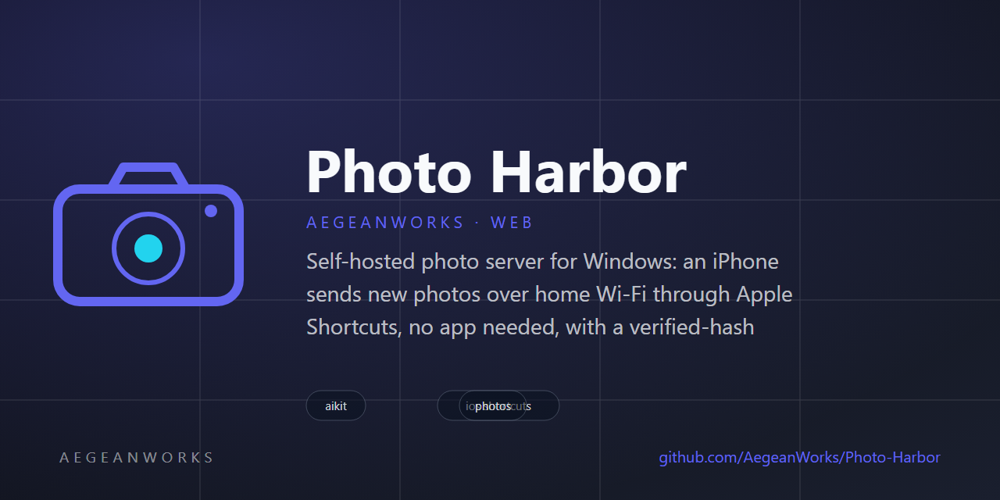

# photo-harbor

<!-- aegean:media:start -->
<p align="center"></p>
*Brand assets are generated and may not fully represent the project scope.*
<!-- aegean:media:end -->

[](https://github.com/AegeanWorks/AIKit)

Self-hosted photo server for Windows: an iPhone sends new photos over home Wi-Fi through Apple Shortcuts, no app needed, with a verified-hash cleanup and a gallery.

## ⚡ 30-Second Cold-Start Quick Reference

- **Runtime Prerequisites**: Python 3.10 or newer (standard library only). Optional: `pip install pillow pillow-heif` for HEIC thumbnails in every browser.
- **Canonical Regression Shield Gate**:
  ```bash
  python -m unittest discover -s tests -t .
  ```
- **Try it now** (from this folder): double-click **`Harbor.pyw`** and press **Start server**,
  then **Open photo browser** (or double-click **`Open Photo Browser.url`**). From a console:
  ```bash
  python -m photo_harbor serve
  ```
  The first time, choose **Sign in with a key instead** and paste the main key shown in the
  window (or printed by `serve`), then set a password under **Setup → My account**. When Windows
  Firewall asks, allow Python on **Private networks** so the iPhone can reach it.

### 🛠️ AIKit Commands (run from the AIKit folder)
| Role | Command |
|---|---|
| Status, task and gates | `python aikit.py status photo-harbor` |
| Phase 4: every gate | `python aikit.py check photo-harbor` |
| Repair memory and map, then check | `python aikit.py fix photo-harbor` |
| Resume an interrupted task | `python aikit.py resume photo-harbor` |

## 💡 How It Works

- **The Harbor window.** `Harbor.pyw` opens a window with a **Start/Stop server** button, the
  iPhone address, everyone's keys with **Copy key**, **Add person**, **Import folder…** and an
  activity log. It remembers the library folder, backup drive, port, "start the server when this
  window opens" and "open the photo browser when the server starts" in
  `%USERPROFILE%\.photo-harbor\panel.json`.
- **Start with Windows.** Tick **Start Harbor when I sign in to Windows** in the window, or flip
  the switch under **Setup → This PC** in the gallery (main key only). Harbor writes one value,
  `Harbor`, to `HKEY_CURRENT_USER\Software\Microsoft\Windows\CurrentVersion\Run`, which runs
  `pythonw.exe Harbor.pyw --startup`. No administrator rights are needed. At sign-in the window
  opens minimised and the server starts at once. Untick it to remove the value.
- **Built for GBs.** Uploads, imports, downloads and re-hashing stream in 4 MB blocks and never
  load a file into memory; uploads up to 16 GiB are accepted, and video seeking uses byte ranges.
  Re-importing a folder skips files already imported (same path, size and modification time,
  photo still present) without reading them. With Pillow installed, a background thread makes
  thumbnails for new photos first and then for every older one, so a large library scrolls
  without waiting, and JPEG previews decode at reduced size. The browser sends 3 uploads at
  once. See *Performance* below for measured numbers.
- **One profile per person, each with their own photos.** Everyone signs in to the photo browser
  with their **name and password** and sees **only their own** photos; the **main** profile sees
  everyone's and manages people (add, rename, set a password, new Shortcut key). A person changes
  their own password under **Setup → My account**, which signs out their other devices. Each
  person's iPhone Shortcut uses their own key. After 5 wrong passwords a device waits 5 minutes.
  Passwords are stored only as salted PBKDF2-SHA256 hashes.
- **Plain folders you can open without Harbor.** The library is ordinary Windows folders:
  `D:\Harbor\Ayşe\2026\2026-10\IMG_1234.HEIC`. One folder per person (named after them, renamed
  with them), then year, then month, then the original file. A photo two people have appears in
  both folders but takes space once (NTFS hard link). A `READ ME - Harbor.txt` in the library
  explains this in English and Turkish, and Harbor's own files sit in the hidden `.harbor`
  folder. **Open library folder** and each person's **More → Open folder** in the window open
  them in File Explorer.
- **Harbor keeps up with File Explorer.** At start and every 6 hours Harbor looks through the
  person folders. A photo dropped into a person's folder joins their photos, a file moved within
  it keeps its place, and a deleted file leaves it. If many files vanish at once (more than 50
  and over 10 %), Harbor assumes the drive is unplugged and removes nothing.
- **Weekly file check.** Once a week, or with **Check all files**, every file is re-read and its
  fingerprint compared. Damaged files are listed in the activity log, never deleted; sending the
  photo again (or the next sync) repairs them.
- **Low disk warning.** Under 20 GB free (or 10 % of the drive) the window and the photo browser
  say so.
- **Import from this PC.** **Import folder…** in the window, `python -m photo_harbor import
  <folder> --profile <id>`, or **Upload → A whole folder…** in a desktop browser. Subfolders
  are scanned, hidden folders and non-media files skipped, the source is never changed, and
  re-running adds only new photos.
- **No iPhone app.** Two Shortcuts built in Apple's Shortcuts app call the server. The gallery's
  **Setup** tab lists every action, with the server address and key ready to copy.
- **Automatic on home Wi-Fi.** Automations run *Harbor Sync* when the phone joins the home
  network and when it is plugged in. The Shortcut stops at once on any other network.
- **Only what is new is sent.** `POST /api/sync/start` returns the time of the last finished
  sync (minus 10 minutes of clock slack). The Shortcut asks `GET /api/has` before each upload,
  so photos already on the PC are only hashed, never re-sent. The sync is marked done only if
  every upload succeeded.
- **Every byte is proven.** The phone sends the SHA-256 of each file with it. The PC streams the
  upload to a temporary file, hashes it, and keeps it only if the hashes match. Then it fsyncs
  the file and moves it into `photos/YYYY/MM/` under its original name. A name clash with different
  bytes gets a hash suffix; identical bytes are stored once.
- **Deletion only after a fresh check.** *Harbor Cleanup* asks `GET /api/has` for each phone photo
  older than 30 days. The PC answers `yes` only after re-hashing its own copy. Only those photos
  are deleted, and iOS asks once to confirm. A `no` uploads the photo instead and appears under
  **Sync → On the iPhone, not yet on the PC** until it arrives.
- **Home network only.** Requests from public IP addresses are refused even if a router forwards
  the port. Every API call needs a signed-in browser session or a profile's key in
  `X-Harbor-Key` (the Shortcuts).
- **A library browser.** The gallery has a sidebar of years and months with counts, a Videos
  filter and search by file name; on a phone the sidebar becomes a scrolling row of chips. Days
  are labelled in the browser's language. Click any photo for a full-screen viewer (arrow keys,
  swipe, download the original).
- **Upload from any browser.** Drop files on the page or press **Upload**, from the PC or from
  the iPhone's photo picker when the Shortcut is not set up. Browser uploads need no hash: the
  PC computes it. Their date is the phone's, else the EXIF capture date (with Pillow), else the
  file's modified time.
- **Second copy.** `--backup-to E:\HarborBackup` mirrors the person folders at start-up and every
  24 hours. It never deletes anything in the backup. A photo shared by two people is copied
  twice there, because the backup drive gets plain copies.

### Commands

```text
python -m photo_harbor [--library DIR] serve [--port 8642] [--host 0.0.0.0] [--backup-to DIR]
python -m photo_harbor [--library DIR] panel            # the Harbor window (same as Harbor.pyw)
pythonw Harbor.pyw --startup                            # what Windows runs at sign-in
python -m photo_harbor [--library DIR] key [--new]      # print, or replace, the main key
python -m photo_harbor [--library DIR] profiles [--add NAME]   # list people and keys, or add one
python -m photo_harbor [--library DIR] import FOLDER [--profile ID]  # copy photos in from disk
python -m photo_harbor [--library DIR] backup --to DIR  # one-off mirror to another drive
```

The default library is `%USERPROFILE%\Pictures\Harbor`. Errors print `Error:`, `Why:` and `Fix:`
and exit 1; usage errors exit 2.

### HTTP API

| Call | Purpose |
|---|---|
| `POST /api/sync/start` | `{since, started_at}`: which photos to send |
| `POST /api/upload` | raw file body; headers `X-Name` (may be percent-encoded), optional `X-Sha256`, `X-Taken`, `X-Modified`, `X-Profile` (owner only). `{status: stored\|duplicate, answer: yes}` |
| `GET /api/has?sha256=…[&name=…&report=1]` | `{present, answer: yes\|no}` after re-hashing the PC's copy |
| `POST /api/sync/done` | JSON `{started_at}`: records a finished sync |
| `GET /api/status`, `GET /api/outline` `[?profile=]` | counts, sync state, months with photos |
| `GET /api/people`, `POST /api/login`, `POST /api/logout` | public sign-in: names; `{profile, password}` or `{key}` → session cookie |
| `POST /api/password` | your own password: `{current, new}` (`current` only once one is set) |
| `GET /api/setup`, `POST /api/startup` | address and start-with-Windows state; owner: `{enabled}` |
| `GET /api/profiles` | owner: everyone; others: themselves (with key, folder, counts, last sync) |
| `POST /api/profiles`, `POST /api/profiles/<id>` | owner: add `{name, password?}`; `{name}` renames (and the folder), `{password}`, `{new_key: true}` |
| `GET /api/photos?offset=&limit=[&month=YYYY-MM&kind=photo\|video&q=name&profile=id]` | gallery page, newest first; non-owners always get their own |
| `GET /media/<sha256>`, `GET /thumb/<sha256>` | original (with byte ranges) and JPEG preview |

## 📦 What's Inside

```text
photo-harbor/
├── .aikit/                   <- this project's memory: record, ledger, decisions
├── .gitignore
├── Harbor.pyw                <- double-click: the Harbor window (Start/Stop server)
├── LICENSE                   <- Aegean License 1.1 (AL-1.1): free personal use
├── LICENSES/                 <- REUSE license texts
├── REUSE.toml                <- Machine-readable SPDX metadata
├── Open Photo Browser.url    <- double-click: the gallery at http://localhost:8642
├── README.md
├── COMMERCIAL.md
├── photo_harbor/
│   ├── __init__.py           <- package version
│   ├── __main__.py           <- `python -m photo_harbor` commands
│   ├── app.py                <- wires storage, APIs and the web page into routes
│   ├── atomic_file.py        <- temp + fsync + replace placement
│   ├── accounts.py           <- password hashes, sessions, wrong-password brake
│   ├── auth.py               <- home-network check; who is asking (key or session); sign-in
│   ├── autostart.py          <- start with Windows (per-user Run key)
│   ├── backup.py             <- mirror to a second drive, daily thread
│   ├── body_readers.py       <- Content-Length and chunked request bodies
│   ├── catalog.py            <- index of stored originals by SHA-256; per-person views
│   ├── copies.py             <- whose folder holds which photo, and where
│   ├── config.py             <- settings file with the library key
│   ├── control_panel.py      <- the Harbor window (tkinter)
│   ├── database.py           <- SQLite file and its format version
│   ├── errors.py             <- the Error/Why/Fix triad
│   ├── exif_dates.py         <- capture date from EXIF, when Pillow is installed
│   ├── http_server.py        <- HTTP handling, byte ranges, security headers
│   ├── importer.py           <- copy photos in from a folder on disk, skip-list of imported files
│   ├── journal.py            <- uploads, finished syncs, photos reported missing, scans
│   ├── layout.py             <- person folders, guide file, old-layout move, folder renames
│   ├── library_api.py        <- status, month outline, filtered photo list, originals, previews
│   ├── messages.py           <- Request and Reply values, Range parsing
│   ├── naming.py             <- safe file names, month folders, media types
│   ├── profiles.py           <- people, folder ids and keys
│   ├── profiles_api.py       <- list, add, rename and re-key people
│   ├── records.py            <- frozen value objects
│   ├── router.py             <- method + path routing
│   ├── runner.py             <- start and stop a server in the background
│   ├── scan.py               <- keeping up with File Explorer; weekly file check
│   ├── setup_api.py          <- address and key for the Setup tab
│   ├── store.py              <- hash-verified ingest and re-verification
│   ├── sync_api.py           <- the endpoints the Shortcuts call
│   ├── thumbs.py             <- optional Pillow previews and the background warmer
│   └── web/                  <- gallery and browser: index.html, app.css, app.js, icon, manifest
└── tests/
    ├── __init__.py
    ├── library_fixture.py    <- a throwaway library for tests
    ├── test_http.py          <- the server over a real socket
    ├── test_naming.py
    ├── test_folders.py
    ├── test_parts.py
    ├── test_profiles.py
    ├── test_runner.py
    ├── test_scale.py
    └── test_store.py
```

Library layout: `<Person>\<YYYY>\<YYYY-MM>\<original name>` holds the originals untouched, next
to `READ ME - Harbor.txt`. Libraries from earlier versions (`photos\...`) are moved into this
layout file by file the first time the server starts. The hidden `.harbor\` holds
`config.json`, `catalog.sqlite3` (format 4; an older catalog is upgraded in place after a copy
to `catalog.sqlite3.v<N>.bak`), `incoming\` and `thumbs\`.

## 🚀 Performance

Measured on the development PC (SATA SSD, Python 3.14, localhost; Wi-Fi is slower than all of
these, so on a phone the network sets the pace):

| Operation | Result |
|---|---|
| Upload of a 1 GB video, hashed and fsynced | 188 MB/s |
| Download of a 1 GB video | 535 MB/s |
| `has` re-hash of a 1 GB video | 1.2 s |
| Import of 200 × 5 MB from disk | 97 MB/s |
| Re-import of the same 200 files | under 0.1 s, nothing read |
| Photo page, month filter, people list with 50,000 photos | 5–32 ms |
| Name search across 50,000 photos | 12 ms |
| One person's photo page, month list, status, search (50,000 photos) | 10-33 ms |
| One person's page 45,000 photos deep | about 150 ms |
| Password check at sign-in | about 40 ms |

## ⚠️ Limits

- The PC must be on, awake and on the same Wi-Fi. "Start with Windows" begins at sign-in, not at
  boot, so the account must sign in (automatic sign-in or staying signed in both work).
- The library needs room: originals are kept untouched, so put it on a drive with space for
  every photo and video (**Choose…** in the window, or `--library`).
- iOS always asks before Shortcuts deletes photos. Deleted photos stay in *Recently Deleted* for
  30 days. With iCloud Photos on, deleting also removes them from iCloud.
- Very large videos may need more than one run because Shortcuts limits how long one run takes.
- Thumbnails need Pillow. Without them, Safari still shows HEIC originals; other browsers show a
  placeholder.

## 📜 License

Free for personal use under the Aegean License 1.1 (AL-1.1); see [LICENSE](LICENSE). Any commercial use needs the Aegean Commercial License 1.0 (ACL-1.0); see [COMMERCIAL.md](COMMERCIAL.md).
